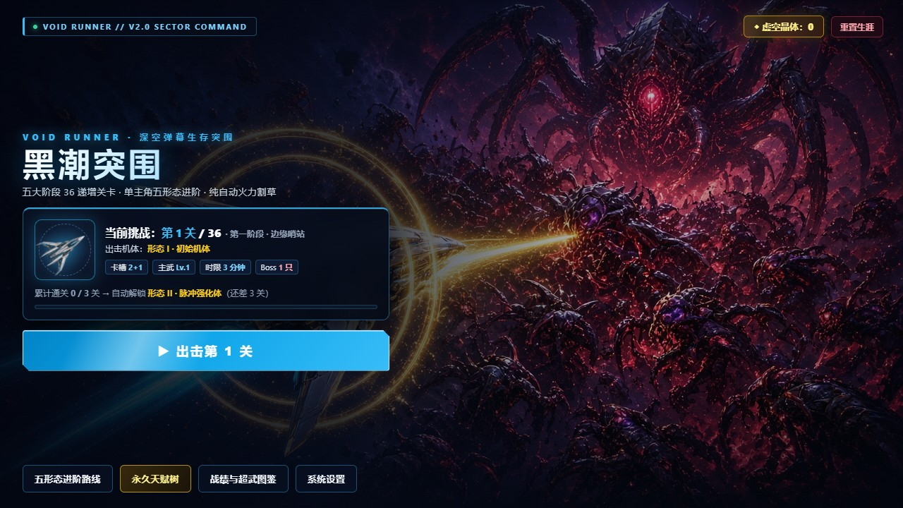
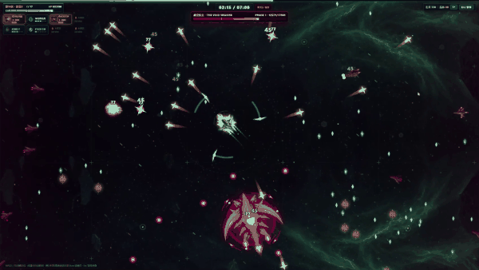
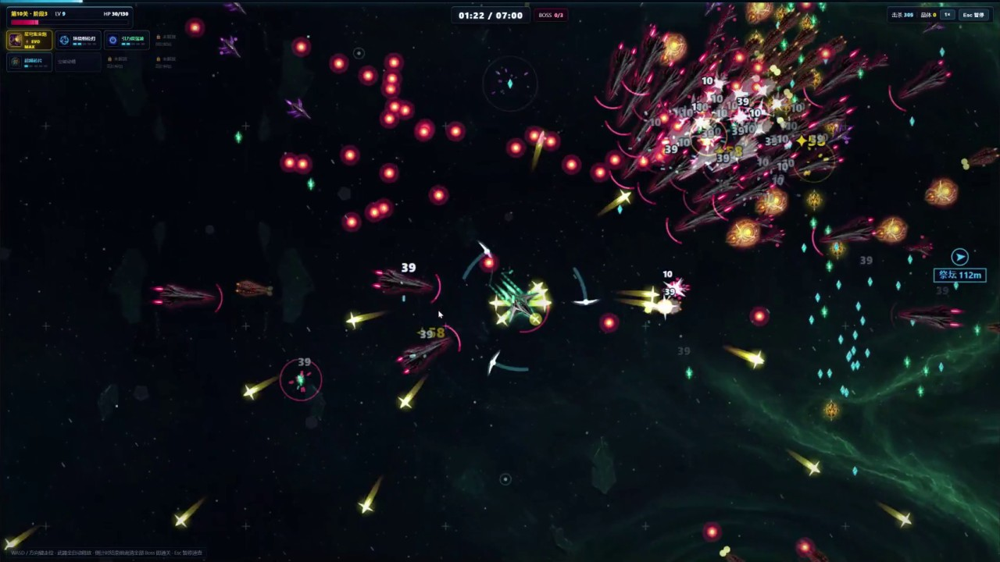
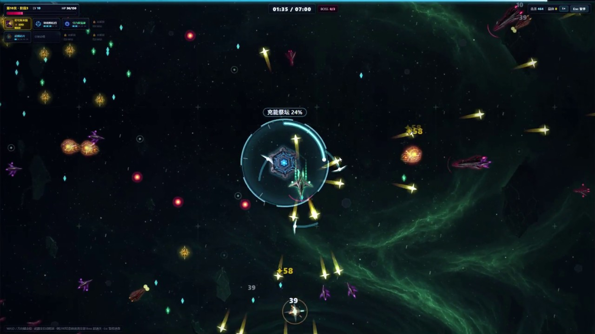
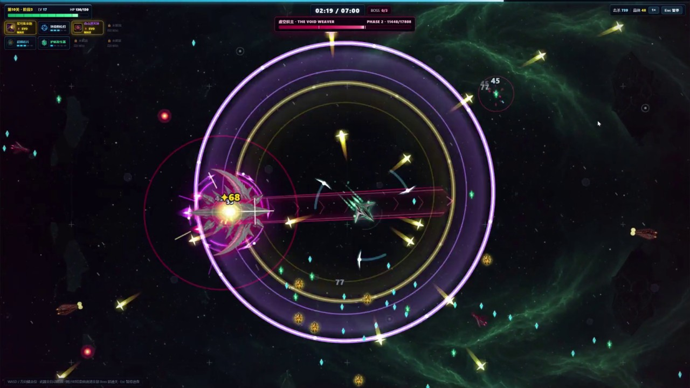
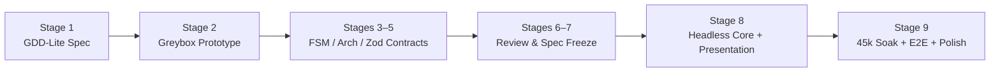

<div align="center">



# VOID RUNNER · 黑潮突围

[简体中文](./README.md) | **English**

**A pure front-end deep-space Bullet-Heaven / Survivors-like web game built end-to-end with SDD-G (Spec-Driven Development for Games)**

[](https://www.typescriptlang.org/)
[](https://vitejs.dev/)
[](https://developer.mozilla.org/en-US/docs/Web/API/Canvas_API)
[](https://developer.mozilla.org/en-US/docs/Web/API/Web_Audio_API)
[](https://zod.dev/)
[](https://playwright.dev/)
[](./LICENSE)
[](https://github.com/wendellhua/web-G/actions/workflows/ci.yml)
[](https://wendellhua.github.io/web-G/)

**[🎮 Play Online Now](https://wendellhua.github.io/web-G/)** · [Gameplay Demo](#-gameplay-demo--screenshots) · [Features](#-core-gameplay--features) · [Quick Start](#-quick-start) · [SDD-G Reference](#-sdd-g-spec-driven-game-development-reference) · [Architecture](#-architecture--quality-gates) · [GitHub Actions Deploy](#-github-actions--pages-deployment)

</div>

> 🎮 **Play Online First (Recommended — Zero Setup, Instant Browser Play)**:  
> 👉 **[https://wendellhua.github.io/web-G/](https://wendellhua.github.io/web-G/)** (Supports `WASD` / Arrow Keys  controls, local save persistence, and `1× / 2× / 3×` battle speed)

---

## Overview

**VOID RUNNER (《黑潮突围》)** is a zero-game-engine, pure browser sci-fi Bullet-Heaven / Survivors-like game engineered with **TypeScript + HTML5 Canvas 2D + Web Audio API**:

- **Tight, High-Intensity Progression**: 5 progressive campaign stages across 36 escalating levels, 5 auto-awakening starfighter forms (`2+1 → 4+4` slots), 6 active weapons × 6 passive cores → 6 evolution super-weapons, multi-phase *Void Weaver* Boss encounters starting at `02:00` with tight 1-minute follow-up waves, holographic laser warning corridors, Charging Altars, and 8 permanent meta talents with free full refunds.
- **Flagship Open-Source SDD-G Reference**: A complete, reproducible showcase of **Spec-Driven Development for Games**—preserving every artifact from a 1-page GDD-Lite and single-file playable greybox prototype (`prototype/index.html`) to Zod-enforced data contracts, a 100% headless deterministic simulation core (`src/core/**`), 45,000-frame headless soak tests, and Playwright real-browser E2E regression suites. To rerun the pipeline, start with the constitution [`docs/CLAUDE.md`](./docs/CLAUDE.md) and the stage prompts in the [`SDD-G workflow handbook`](./docs/SDD-G工作流提示词手册.md).

---

## 🎬 Gameplay Demo & Screenshots

### Live Combat Preview (*Void Weaver* Boss · Holographic Laser Corridor + Singularity Ring + Star Cluster Barrage)

<div align="center">



</div>

### Full 3-Act Gameplay Showcase Video (26s · Swarm Clear → Holographic Altar → Boss Phase 2 Showdown)

<div align="center">

<video src="./docs/media/gameplay-demo.mp4" controls muted playsinline width="820">
  Your browser or Markdown viewer does not support inline video playback. Use the direct link below to view or download.
</video>

> 📺 **Watch / Download HD Gameplay Video**: [gameplay-demo.mp4](./docs/media/gameplay-demo.mp4) (16:9 clean game viewport, H.264)

</div>

### High-Resolution Screenshot Gallery

<table>
  <tr>
    <td width="50%" align="center">
      
      <br />
      <sub><b>Sector Command Title Screen</b> · Form Codex, Talent Tree & Evolution Gallery</sub>
    </td>
    <td width="50%" align="center">
      
      <br />
      <sub><b>Deep-Space Bullet-Heaven Combat</b> · Star Cluster meteor salvos & fleet clashes</sub>
    </td>
  </tr>
  <tr>
    <td width="50%" align="center">
      
      <br />
      <sub><b>Holographic Charging Altar</b> · Hold the zone for 5s for a shockwave & blessing draft</sub>
    </td>
    <td width="50%" align="center">
      
      <br />
      <sub><b>Void Weaver Boss Battle</b> · Holographic crimson laser corridors, charge tendrils & dash afterimages</sub>
    </td>
  </tr>
</table>

---

## 🎮 Core Gameplay & Features

### 1. Five-Stage Progressive Campaign (36 Levels · Tight 1-Min Follow-Up Boss Cadence · Instant Victory on Final Kill)

Every stage spawns its first multi-phase *Void Weaver* Boss at `02:00`; on multi-Boss stages, each subsequent Boss arrives **every 1 minute** after the first (e.g., `02:00 / 03:00 / 04:00 / 05:00` for 4 Bosses) while stage timers remain unchanged. **Eliminating all required Bosses immediately completes the level and triggers settlement** (failing to clear them before the timer expires triggers a timeout defeat while preserving your current level and earned Void Crystals):

| Stage | Levels | Auto-Unlocked Starfighter Form | Starter Weapon | Slot Cap (Active+Passive) | Boss Count (02:00, then +1m) | Time Limit | Highlights |
| :---: | :---: | :--- | :---: | :---: | :---: | :---: | :--- |
| **Stage 1** | Lv. 1 – 3 | Form I · Initiate Frame | `Lv.1` | `2 + 1` | **1** (`02:00`) | **3 min** | Fast-paced intro trial & tight build draft |
| **Stage 2** | Lv. 4 – 8 | Form II · Pulse Striker | `Lv.2` | `2 + 2` | **2** (`02:00 / 03:00`) | **5 min** | Adds Spitters, Heavy Tanks & Crimson Vanguard Elites |
| **Stage 3** | Lv. 9 – 16 | Form III · Phase Raider | `Lv.3` | `3 + 2` | **3** (`02:00 / 03:00 / 04:00`) | **7 min** | Adds Bombers, Abyssal Prisms & dual Charging Altars |
| **Stage 4** | Lv. 17 – 25 | Form IV · Astral Sovereign | `Lv.4` | `3 + 3` | **4** (`02:00 / 03:00 / 04:00 / 05:00`) | **9 min** | Adds Splitters, full enemy roster & +20% late-game pressure |
| **Stage 5** | Lv. 26 – 36 | Form V · Void Apex | `Lv.5` | `4 + 4` | **5 Distinct** (`02:00 – 06:00`) | **9 min** | Full 4+4 slots, 5 unique Bosses culminating in Void Empress, unlocks **Endless Mode** |

### 2. Six Active Weapons × Six Passive Cores → Six Evolution Super-Weapons

Level an active weapon to `Lv.5` while holding its paired passive (`≥ Lv.1`) to unlock its **Evolution Awakening**:

| Active Weapon | Paired Passive Core | Evolution Super-Weapon | Signature Upgrade |
| :--- | :--- | :--- | :--- |
| **Tracking Pulse** | Overclock Chip (Attack) | **Star Cluster** | 6 piercing golden plasma lances with splash shock arcs |
| **Orbital Blade** | Quantum Accel (Cooldown) | **Stellar Saw** | Dual-ring 8 high-speed golden blades shredding close threats |
| **Void Lightning** | Wide Amp (Area) | **Thunder Storm** | 6 violet sky-bolts with 2-hop chain lightning bursts |
| **Gravity Nova** | Shield Gen (HP & Regen) | **Singularity Ring** | Massive knockback shockwave followed by high-damage collapse |
| **Rift Beam** | Precision Scope (Crit) | **Annihilation Ray** | Triple-forked heavy laser cannons with low-HP execute bonus |
| **Boomerang Matrix** | Warp Thruster (Move Speed) | **Spiral Cutter** | 6 giant crescent plasma chakrams scaling with move speed |

### 3. Hard-Surface Painted Art & Zero-Asset Procedural Web Audio

- **Cohesive Painted Asset Pipeline**: 23 transparent hard-surface painted PNG sprites (5 starfighter forms + 10 enemies/elites/Boss + 8 tactical props/gems), 26 painted UI skill/talent icons, and 5 seamless parallax deep-space nebula backdrops.
- **High-Readability Holographic VFX**: Translucent crimson laser warning corridors with scrolling directional chevrons (`>>>`), Boss inward-collapsing energy tendrils, pooled dash afterimage silhouettes, parabolic bow-shock cones, feathered plasma thruster plumes, and 4-point plasma hit flashes.
- **Procedural Synthwave Web Audio Engine**: Zero external audio files—multi-layer LFO + rhythmic pulse Synthwave BGM and pre-baked filtered noise burst SFX synthesized live in Web Audio API.

### 4. Controls

| Action | Input |
| :--- | :--- |
| Move | `W A S D` / Arrow Keys / Mouse or Touch drag (all weapons auto-aim & auto-fire) |
| Draft Card Selection | Click card or press `1` / `2` / `3` |
| Reroll Draft | Press `R` or click Reroll |
| Battle Speed Toggle | Top-right HUD toggle `1×` / `2×` / `3×` |
| Pause & Settings | `Esc` / `P` (Evolution cheat sheet, DPS breakdown, Low-Particle / No-Shake / No-Text toggles) |

---

## 🚀 Quick Start

### Prerequisites

- **Node.js** `>= 20.0.0` (Node 22 LTS recommended)
- **npm** `>= 10.0.0`

### Run Locally

```bash
# 1. Install dependencies
npm ci

# 2. Start Vite dev server (http://localhost:5173)
npm run dev
```

> Tip: Append `?debug=1` (`http://localhost:5173/?debug=1`) in dev mode to expose the controlled test bridge `window.__VOID_RUNNER_DEBUG__`.

### Engineering & Quality-Gate Commands

```bash
npm run typecheck   # Strict TypeScript check (tsc --noEmit)
npm run lint        # ESLint across schemas/, src/, and tests/ (enforces headless core isolation)
npm run test:unit   # Vitest unit tests (43 tests: FSM, determinism, Zod contracts, evolutions)
npm run test:sim    # Headless 45,000-frame multi-Boss stress soak across all 5 stages
npm run test:e2e    # Playwright real-browser E2E regression suite (3 full-flow specs)
npm run build       # Production bundle to dist/ (relative paths ready for GitHub Pages)
npm run check       # Run typecheck + lint + test:unit + test:sim + build in one command
```

---

## 🧭 SDD-G (Spec-Driven Game Development) Reference

This repository is designed as a **complete, reproducible open-source reference for SDD-G (Spec-Driven Development for Games)**—locking down playable mechanics and verifiable schemas *before* writing production code, then validating every iteration through headless simulation and real-browser E2E gates.



Documents 01–09 below are the frozen artifacts of *this* game. Two Chinese rule documents still govern how to run the same pipeline again: the constitution says what each stage may do, and the handbook turns those rules into prompts you copy one stage at a time.

### Constitution and prompt handbook

| Document | Role | How to use it |
| :--- | :--- | :--- |
| [`docs/CLAUDE.md`](./docs/CLAUDE.md) | **Project constitution** | It states the hard rules for every stage. Stage 1 clarifies play and writes no code. The Stage 2 greybox stays in `prototype/` and is never imported by `src/`. Stages 3–7 do not edit production code until that work is approved. Sections 4–7 lock the engineering red lines: `src/core/` must not touch browser APIs or `Math.random()`, simulation advances at a fixed `1/60` step, config and saves are validated, presentation only reads snapshots, and release waits on `typecheck`, `lint`, `test:unit`, `test:sim`, and `test:e2e`. |
| [`docs/SDD-G工作流提示词手册.md`](./docs/SDD-G工作流提示词手册.md) | **Nine-stage prompt handbook** | Pair it with the constitution. Every stage prompt tells the session to read the matching section of `CLAUDE.md`, then names the input documents, the artifact to freeze, and what is out of bounds. Stage 8 is five separate prompts: L1 scaffold → L2 headless core → L3 presentation → L4 UI → L5 content. Copy the next prompt only after a person signs the current artifact. |

| Handbook stage | Constitution section | Artifact that stage freezes |
| :--- | :--- | :--- |
| 1 Concept and rules | §1 | [`docs/01`](./docs/01.游戏设计规格书%28GDD-Lite%29.md) GDD-Lite |
| 2 Greybox | §2 | [`prototype/`](./prototype/index.html) + [`docs/02`](./docs/02.灰盒原型验证结论.md) |
| 3 Modules and FSM | §3 | [`docs/03`](./docs/03.系统模块与状态流转设计.md) |
| 4 Runtime architecture | §4 | [`docs/04`](./docs/04.技术选型与运行时架构设计.md) |
| 5 Data and saves | §5 | [`docs/05`](./docs/05.数据模型与配置表设计.md) + `schemas/` |
| 6 Interfaces and AV | §6 | [`docs/06`](./docs/06.模块接口与资源视听规范.md) |
| 7 Review and freeze | §3, plus a cross-document audit | [`docs/07`](./docs/07.设计方案评审与冻结报告.md), including the L1–L5 task topology |
| 8 Layered implementation | §§4–7 | `src/`, delivered L1→L5; each layer passes `typecheck` + `lint` + `test:unit` |
| 9 Soak, E2E, and tuning | §7.3 | `tests/simulation/`, `tests/e2e/` + [`docs/08`](./docs/08.质量验收与调优报告.md) |

The [art bible (`docs/09`)](./docs/09.美术风格圣经与资产清单规范.md) was written after the freeze to lock visuals and the asset manifest. It is not a separate coding stage in the handbook. Stages 8 and 9 produce code and tests directly, so they do not add another design volume with the same name.

### Complete bilingual SDD-G documentation map

| Stage / Topic | English Version | Chinese Original (中文原版) | Description |
| :--- | :--- | :--- | :--- |
| **Docs Index** | [`docs/en/README.md`](./docs/en/README.md) | [`README.md`](./README.md) | Full navigable index of all SDD-G stage specs |
| **Stage 1 · GDD-Lite** | [`01-game-design-spec.md`](./docs/en/01-game-design-spec.md) | [`01.游戏设计规格书(GDD-Lite).md`](./docs/01.游戏设计规格书%28GDD-Lite%29.md) | Core loop, 5-stage campaign, win/loss rules & meta progression |
| **Stage 2 · Greybox** | [`02-greybox-validation.md`](./docs/en/02-greybox-validation.md) & [`prototype/index.html`](./prototype/index.html) | [`02.灰盒原型验证结论.md`](./docs/02.灰盒原型验证结论.md) | Zero-dependency playable greybox prototype & tuned feel baselines |
| **Stage 3 · Modules & FSM** | [`03-system-modules-and-fsm.md`](./docs/en/03-system-modules-and-fsm.md) | [`03.系统模块与状态流转设计.md`](./docs/03.系统模块与状态流转设计.md) | App/Run FSM, same-frame race arbitration & Clean Reset contract |
| **Stage 4 · Architecture** | [`04-tech-stack-and-runtime-arch.md`](./docs/en/04-tech-stack-and-runtime-arch.md) | [`04.技术选型与运行时架构设计.md`](./docs/04.技术选型与运行时架构设计.md) | Headless decoupling, `1/60s` fixed timestep, SpatialHashGrid & 60fps budgets |
| **Stage 5 · Data & Save** | [`05-data-models-and-configs.md`](./docs/en/05-data-models-and-configs.md) | [`05.数据模型与配置表设计.md`](./docs/05.数据模型与配置表设计.md) | Static config tables, Save Schema V2 migration & Zod `superRefine` rules |
| **Stage 6 · Interfaces & AV** | [`06-interfaces-and-av-spec.md`](./docs/en/06-interfaces-and-av-spec.md) | [`06.模块接口与资源视听规范.md`](./docs/06.模块接口与资源视听规范.md) | Readonly snapshots, controller contracts, test bridge & AV rules |
| **Stage 7 · Spec Freeze** | [`07-design-review-and-freeze.md`](./docs/en/07-design-review-and-freeze.md) | [`07.设计方案评审与冻结报告.md`](./docs/07.设计方案评审与冻结报告.md) | Cross-document consistency audit & spec freeze sign-off |
| **Stage 8 · Art Bible** | [`09-art-bible-and-asset-manifest.md`](./docs/en/09-art-bible-and-asset-manifest.md) | [`09.美术风格圣经与资产清单规范.md`](./docs/09.美术风格圣经与资产清单规范.md) | Visual identity, faction contrast rules, 6-layer Z-order & asset manifest |
| **Stage 9 · QA & Tuning** | [`08-qa-and-tuning-report.md`](./docs/en/08-qa-and-tuning-report.md) | [`08.质量验收与调优报告.md`](./docs/08.质量验收与调优报告.md) | 6-gate automation results, 45k-frame soak metrics & E2E coverage |

---

## 🏗️ Architecture & Quality Gates

### Unidirectional Data Flow & Strict Headless Separation

```text
InputNormalizer (Keyboard / Pointer / Touch)
        │
        ▼
GameController (Fixed-Timestep 1/60s Accumulator + SaveManager)
        │
        ▼
SimulationWorld [src/core/** — 100% Headless & Deterministic]
  ├── SeededRng (Mulberry32)
  ├── SpatialHashGrid (Zero-GC Collision Queries)
  ├── ProgressionSystem (Slot-Isolated Draft + Evolutions + Fallback)
  └── EconomyCalculator (Crystals & Two-Phase Settlement)
        │
        ├── RenderSnapshot (Read-Only) ──► CanvasRenderer (60fps Pooled VFX)
        ├── HudSnapshot    (Read-Only) ──► UiOverlayManager (DOM HUD & Modals)
        └── GameEvent[]    (Read-Only) ──► SynthAudioEngine (Procedural Web Audio)
```

---

## ⚙️ GitHub Actions & Pages Deployment

Pre-configured workflows are ready out of the box:

1. **Continuous Integration ([`.github/workflows/ci.yml`](./.github/workflows/ci.yml))**
   - Runs all 6 quality gates (`typecheck`, `lint`, `test:unit`, `test:sim`, `build`, and Playwright Chromium `test:e2e`) on every push and pull request.
2. **Automatic GitHub Pages Deployment ([`.github/workflows/deploy-pages.yml`](./.github/workflows/deploy-pages.yml))**
   - **Live Playable Build**: 👉 **[https://wendellhua.github.io/web-G/](https://wendellhua.github.io/web-G/)** (automatically rebuilt and published on every push to `main`).
   - `vite.config.ts` sets `base: './'` so all assets resolve cleanly under `https://<username>.github.io/<repo>/`.
   - **Enable on a Fork (2 Steps)**:
     1. Push this repository to GitHub (`main` or `master` branch).
     2. Open **Settings → Pages → Build and deployment → Source**, select **`GitHub Actions`**, and your playable build publishes automatically!

---

## 🤝 Contributing & License

- Contributions are welcome! Please review [`CONTRIBUTING.md`](./CONTRIBUTING.md) before opening a PR.
- Released under the [**MIT License**](./LICENSE).
