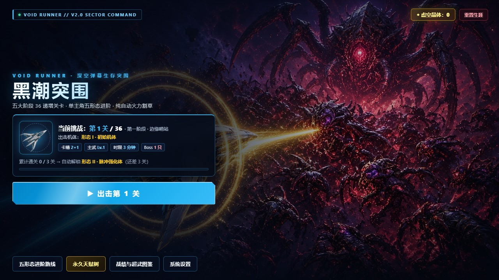
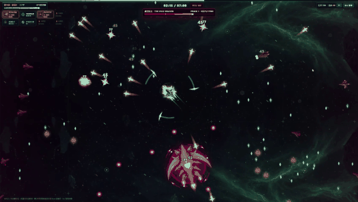
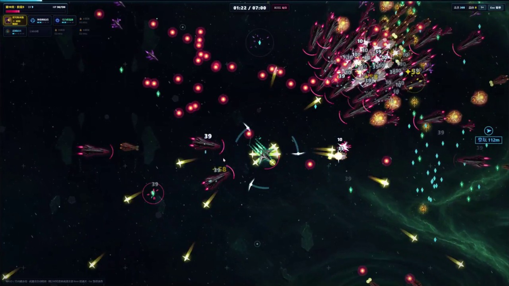
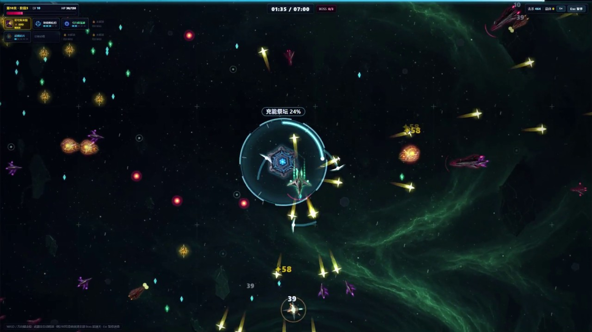
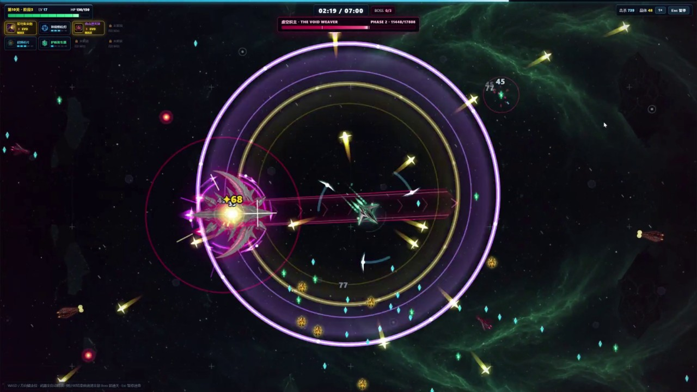

<div align="center">



# 黑潮突围 · VOID RUNNER

**简体中文** | [English](./README.en.md)

**一款基于 SDD-G（规格驱动游戏开发）方法论构建的纯前端深空弹幕生存割草游戏**

[](https://www.typescriptlang.org/)
[](https://vitejs.dev/)
[](https://developer.mozilla.org/en-US/docs/Web/API/Canvas_API)
[](https://developer.mozilla.org/en-US/docs/Web/API/Web_Audio_API)
[](https://zod.dev/)
[](https://playwright.dev/)
[](./LICENSE)
[](https://github.com/wendellhua/web-G/actions/workflows/ci.yml)
[](https://wendellhua.github.io/web-G/)

**[🎮 立即在线试玩](https://wendellhua.github.io/web-G/)** · [实机演示](#-实机演示与画面一览) · [核心玩法](#-核心玩法与内容特色) · [快速开始](#-快速开始) · [SDD-G 工程实践](#-sdd-g-规格驱动开发全流程参考) · [架构设计](#-技术架构与质量门禁) · [GitHub Actions 部署](#-github-actions--pages-一键部署)

</div>

> 🎮 **推荐优先在线体验（无需下载与配置环境，打开浏览器即玩）**：  
> 👉 **[https://wendellhua.github.io/web-G/](https://wendellhua.github.io/web-G/)**（支持桌面端 `WASD` / 方向键移动，内置本地存档与 `1× / 2× / 3×` 变速）

---

## 简介

**《黑潮突围（VOID RUNNER）》** 是一款零重型游戏引擎依赖、纯原生 **TypeScript + HTML5 Canvas 2D + Web Audio API** 打造的深空科幻弹幕生存（Survivors-like / Bullet-Heaven）网页游戏：

- **紧凑高能的割草推图体验**：五大渐进阶段 × 36 递增关卡、五阶星舰形态自动觉醒、6 大主动武器 × 6 大被动核心 → 6 大超武进化公式、首只 02:00 降临且后续每 1 分钟压轴登场的多阶段 Boss「虚空织主」、全息激光预警走廊、充能祭坛与 8 项永久局外天赋树。
- **SDD-G（Spec-Driven Development for Games）经典开源范本**：完整沉淀了从 1 页游戏设计规格书（GDD-Lite）、单文件灰盒手感原型、Zod 强契约数据表、纯无头确定性仿真内核（支持 45,000 帧自动化压测）到 Playwright 真实浏览器 E2E 回归的全链路工程资产。重做这条流水线时，先读规则宪章 [`docs/CLAUDE.md`](./docs/CLAUDE.md)，再按 [`SDD-G 工作流提示词手册`](./docs/SDD-G工作流提示词手册.md) 逐阶段执行。

---

## 🎬 实机演示与画面一览

### 实机战斗动态预览（虚空织主 Boss 战 · 全息激光走廊 + 奇点湮灭环 + 星穹集束炮）

<div align="center">



</div>

### 完整实机剪辑视频（26s 三幕高能实机：怪潮割草 → 全息祭坛 → Boss 二阶段对决）

<div align="center">

<video src="./docs/media/gameplay-demo.mp4" controls muted playsinline width="820">
  你的浏览器或当前预览器暂不支持内嵌视频播放，可直接点击下方链接观看或下载。
</video>

> 📺 **观看 / 下载高清实机演示视频**：[gameplay-demo.mp4](./docs/media/gameplay-demo.mp4)（16:9 纯游戏画面，H.264 编码）

</div>

### 实机高清截图画廊

<table>
  <tr>
    <td width="50%" align="center">
      
      <br />
      <sub><b>主标题与生涯指挥台</b> · 形态路线、天赋树、超武图鉴</sub>
    </td>
    <td width="50%" align="center">
      
      <br />
      <sub><b>高密深空黑潮割草</b> · 星穹集束炮流星雨与多舰队交火</sub>
    </td>
  </tr>
  <tr>
    <td width="50%" align="center">
      
      <br />
      <sub><b>全息充能祭坛</b> · 站入 5 秒触发全域清场震爆与赐福三选一</sub>
    </td>
    <td width="50%" align="center">
      
      <br />
      <sub><b>虚空织主 Boss 战</b> · 全息激光预警走廊、吸能光丝与冲锋残影</sub>
    </td>
  </tr>
</table>

---

## 🎮 核心玩法与内容特色

### 1. 五阶段紧凑推图节拍（36 递增关卡 · 02:00 起每 1 分钟刷 Boss · 消灭即结算）

每局首只多阶段 Boss「虚空织主」于 `02:00` 准点降临；当关卡 Boss 数量大于 1 时，后续 Boss 每隔 **1 分钟** 紧凑接连刷新（如 4 只 Boss 依次为 `02:00 / 03:00 / 04:00 / 05:00`），**只要击杀本关规定数量的全部 Boss 即立刻完成关卡结算**（超时未全杀则判败且保持当前关卡进度）：

| 阶段 | 关卡范围 | 自动觉醒机体形态 | 初始主武 | 动态槽位上限 | Boss 数量（02:00 起每 1 分钟） | 关卡时限 | 特色机制 |
| :---: | :---: | :--- | :---: | :---: | :---: | :---: | :--- |
| **阶段 1** | 第 1 ~ 3 关 | 形态 I · 初始机体 | `Lv.1` | `2 主动 + 1 被动` | **1 只**（`02:00`） | **3 分钟** | 快节奏新手试炼与紧凑构筑 |
| **阶段 2** | 第 4 ~ 8 关 | 形态 II · 脉冲强化体 | `Lv.2` | `2 主动 + 2 被动` | **2 只**（`02:00 / 03:00`） | **5 分钟** | 引入虚空射手、重甲驱逐舰与猩红先锋 |
| **阶段 3** | 第 9 ~ 16 关 | 形态 III · 相位突袭体 | `Lv.3` | `3 主动 + 2 被动` | **3 只**（`02:00 / 03:00 / 04:00`） | **7 分钟** | 新增熔核自爆体、深渊棱镜与双座祭坛 |
| **阶段 4** | 第 17 ~ 25 关 | 形态 IV · 星域主宰体 | `Lv.4` | `3 主动 + 3 被动` | **4 只**（`02:00 / 03:00 / 04:00 / 05:00`） | **9 分钟** | 裂变母体加入，高强后期怪潮与 Boss 压迫 |
| **阶段 5** | 第 26 ~ 36 关 | 形态 V · 虚空终焉体 | `Lv.5` | `4 主动 + 4 被动` | **5 只全差异化**（`02:00 ~ 06:00`） | **9 分钟** | 4+4 全槽解放，5 只各异终极 Boss 压轴，通关解锁 **无尽黑潮模式** |

### 2. 六大主动武器 × 六大被动核心 → 六大超武觉醒

主武器升至 `Lv.5` 且持有对应被动核心（`≥ Lv.1`）后，即可在升级或宝箱/祭坛中触发 **超武进化觉醒**：

| 主动武器 | 配对被动核心 | 超武觉醒名称 | 核心视觉与机制特性 |
| :--- | :--- | :--- | :--- |
| **追踪脉冲枪** | 超频芯片（攻击力） | **星穹集束炮** | 6 束高穿透炽金追踪等离子光矛，命中迸发溅射电弧 |
| **环绕相位刃** | 量子加速器（冷却缩减） | **恒星绞肉环** | 双层 8 枚高速公转电光金星环，无死角近身撕裂结界 |
| **虚空天雷** | 广域增幅器（攻击范围） | **天罚雷暴阵** | 6 道虹紫天罚雷柱 + 二段连锁跳跃高伤震爆 |
| **引力震荡波** | 护盾发生器（生命/秒回） | **奇点湮灭环** | 超大范围震退波紧接奇点坍缩二次爆发 |
| **裂隙穿透束** | 精密瞄准镜（暴击/爆伤） | **湮灭主炮射线** | 三叉超宽毁灭激光束，附带低血斩杀加伤 |
| **回旋矩阵刃** | 跃迁推进器（移动速度） | **无限螺旋切刃** | 6 枚巨型穿透弯月旋刃，移速越高切割伤害越高 |

### 3. 硬表面厚涂美术与零外链程序化合成器音效

- **统一硬表面厚涂管线**：23 个局内实体精灵（5 阶主角星舰 + 10 种敌怪/精英/Boss + 8 种战术道具与结晶）与 26 枚技能/天赋图标全部采用透明底精绘 PNG，搭配 5 阶段无缝视差深空星云背景。
- **高可读性全息战斗 VFX**：全息激光预警走廊（方向滚动箭头 + 临界锁定闪烁）、Boss 蓄力向内坍缩吸能光丝、高速冲锋残影对象池与抛物线超音速激波弧、羽化等离子引擎尾焰、4 点星芒受击闪爆。
- **程序化 Web Audio 合成器**：无需下载任何外部音频文件，纯 Web Audio API 实时合成多层次 Synthwave 电子脉冲背景音轨与预烘焙噪声爆破音效，支持音量分级与一键静音。

### 4. 操作方式

| 操作 | 按键 / 交互 |
| :--- | :--- |
| 移动走位 | `W A S D` / 方向键 / 鼠标或触屏虚拟摇杆拖拽（武器全自动瞄准开火） |
| 升级 / 祭坛三选一 | 鼠标点击卡片 或 快捷键 `1` / `2` / `3` |
| 重随升级选项 | 快捷键 `R` 或点击重随按钮 |
| 战斗倍速切换 | 右上角快捷切换 `1×` / `2×` / `3×` |
| 暂停 / 系统设置 | `Esc` 或右上角暂停按钮（支持低粒子模式、关闭震屏、关闭飘字） |

---

## 🚀 快速开始

### 环境要求

- **Node.js** `>= 20.0.0`（推荐 Node 22 LTS）
- **npm** `>= 10.0.0`

### 本地运行

```bash
# 1. 安装依赖
npm ci

# 2. 启动本地开发服务器（默认 http://localhost:5173）
npm run dev
```

> 提示：在开发模式下访问 `http://localhost:5173/?debug=1` 将挂载受控测试桥 `window.__VOID_RUNNER_DEBUG__`，便于调试 Boss、祭坛、无敌或倍速。

### 常用工程命令

```bash
npm run typecheck   # TypeScript 严格静态类型检查（tsc --noEmit）
npm run lint        # ESLint 全仓库代码规范检查（schemas / src / tests）
npm run test:unit   # Vitest 核心逻辑、FSM、确定性与配置契约单元测试（43 用例）
npm run test:sim    # 无头仿真器 45,000 帧五阶段多 Boss 压测与零泄漏验收
npm run test:e2e    # Playwright 真实浏览器端到端回归测试（3 条核心链路）
npm run build       # 生产构建（输出至 dist/，已配置相对路径适配 GitHub Pages）
npm run check       # 一键串行执行 typecheck + lint + test:unit + test:sim + build
```

---

## 🧭 SDD-G 规格驱动开发全流程参考

本项目是 **SDD-G（Spec-Driven Development for Games，规格驱动网页游戏开发）** 的完整开源实战样例——**先以可验证文档与 Schema 锁定规则，再用灰盒原型校准手感，最后按无头内核与多道自动化门禁稳定交付**。


下方 01–09 是《黑潮突围》已经冻结的阶段产物。同一条流水线要在下一款网页游戏里重跑，先读仍在生效的两份规则：宪章规定每个阶段允许做什么，提示词手册把这些规则变成可以逐段复制的会话。

### 规则宪章与提示词手册

| 文档 | 角色 | 怎么用 |
| :--- | :--- | :--- |
| [`docs/CLAUDE.md`](./docs/CLAUDE.md) | **项目级规则宪章** | 它写的是各阶段硬约束。阶段 1 只澄清玩法，禁止写代码。阶段 2 的灰盒留在 `prototype/`，禁止被 `src/` 引用。阶段 3–7 未获批准，禁止改生产代码。第 4–7 节锁定技术红线：`src/core/` 禁止浏览器 API 与 `Math.random()`、固定步长 `1/60`、配置与存档、模块通信，以及 `typecheck` / `lint` / `test:unit` / `test:sim` / `test:e2e` 门禁。 |
| [`docs/SDD-G工作流提示词手册.md`](./docs/SDD-G工作流提示词手册.md) | **9 阶段执行手册** | 与宪章配对使用。阶段 1→9 每段提示词都要求先读 `CLAUDE.md` 的对应章节，并写明输入文档、目标产物和禁止事项。阶段 8 拆成五条独立提示词：L1 骨架 → L2 无头内核 → L3 表现层 → L4 UI → L5 内容填充。一阶段经人工确认并冻结后，才复制下一阶段。 |

| 手册阶段 | 必须遵守的宪章 | 本阶段冻结的产物 |
| :--- | :--- | :--- |
| 1 概念与玩法 | 第 1 节 | [`docs/01`](./docs/01.游戏设计规格书%28GDD-Lite%29.md) 游戏设计规格书 |
| 2 灰盒验证 | 第 2 节 | [`prototype/`](./prototype/index.html) + [`docs/02`](./docs/02.灰盒原型验证结论.md) |
| 3 模块与状态机 | 第 3 节 | [`docs/03`](./docs/03.系统模块与状态流转设计.md) |
| 4 运行时架构 | 第 4 节 | [`docs/04`](./docs/04.技术选型与运行时架构设计.md) |
| 5 数据与存档 | 第 5 节 | [`docs/05`](./docs/05.数据模型与配置表设计.md) + `schemas/` |
| 6 通信与视听 | 第 6 节 | [`docs/06`](./docs/06.模块接口与资源视听规范.md) |
| 7 评审冻结 | 第 3 节，并交叉审计全文 | [`docs/07`](./docs/07.设计方案评审与冻结报告.md)，含 L1–L5 任务拓扑 |
| 8 分层实现 | 第 4–7 节 | `src/` 按 L1→L5 交付，每层过 `typecheck` + `lint` + `test:unit` |
| 9 压测与调优 | 第 7.3 节 | `tests/simulation/`、`tests/e2e/` + [`docs/08`](./docs/08.质量验收与调优报告.md) |

[`docs/09` 美术风格圣经](./docs/09.美术风格圣经与资产清单规范.md) 在规格冻结之后补齐视觉与资产清单，不单独占手册里的一个编码阶段。阶段 8、9 的提示词直接产出代码与测试，不再另写一份同名设计书。

### 完整 SDD 文档导航（支持中英双语查阅 · [English Docs Index](./docs/en/README.md)）

| 分类 | 中文原版文档 | English Version | 内容说明 |
| :--- | :--- | :--- | :--- |
| **阶段 1 · 游戏设计** | [`docs/01.游戏设计规格书(GDD-Lite).md`](./docs/01.游戏设计规格书%28GDD-Lite%29.md) | [`01-game-design-spec.md`](./docs/en/01-game-design-spec.md) | 核心循环、五阶段推图、战斗胜负与局外成长规格 |
| **阶段 2 · 灰盒验证** | [`docs/02.灰盒原型验证结论.md`](./docs/02.灰盒原型验证结论.md) & [`prototype/index.html`](./prototype/index.html) | [`02-greybox-validation.md`](./docs/en/02-greybox-validation.md) | 零依赖单文件可运行灰盒手感原型与实测参数基线 |
| **阶段 3 · 模块与 FSM** | [`docs/03.系统模块与状态流转设计.md`](./docs/03.系统模块与状态流转设计.md) | [`03-system-modules-and-fsm.md`](./docs/en/03-system-modules-and-fsm.md) | 宏观状态机、模态仲裁优先级与系统解耦设计 |
| **阶段 4 · 运行时架构** | [`docs/04.技术选型与运行时架构设计.md`](./docs/04.技术选型与运行时架构设计.md) | [`04-tech-stack-and-runtime-arch.md`](./docs/en/04-tech-stack-and-runtime-arch.md) | 固定步长 `dt=1/60s`、SpatialHashGrid 与渲染分层 |
| **阶段 5 · 数据契约** | [`docs/05.数据模型与配置表设计.md`](./docs/05.数据模型与配置表设计.md) | [`05-data-models-and-configs.md`](./docs/en/05-data-models-and-configs.md) | 配置表结构、存档 V2 Schema 与跨表 `superRefine` 校验 |
| **阶段 6 · 接口与视听** | [`docs/06.模块接口与资源视听规范.md`](./docs/06.模块接口与资源视听规范.md) | [`06-interfaces-and-av-spec.md`](./docs/en/06-interfaces-and-av-spec.md) | Snapshot/Event 单向接口、配色与程序化音画规范 |
| **阶段 7 · 冻结评审** | [`docs/07.设计方案评审与冻结报告.md`](./docs/07.设计方案评审与冻结报告.md) | [`07-design-review-and-freeze.md`](./docs/en/07-design-review-and-freeze.md) | 跨文档一致性审查与开发前规格冻结结论 |
| **阶段 8 · 美术圣经** | [`docs/09.美术风格圣经与资产清单规范.md`](./docs/09.美术风格圣经与资产清单规范.md) | [`09-art-bible-and-asset-manifest.md`](./docs/en/09-art-bible-and-asset-manifest.md) | 暗空赛博硬表面美术方向、资产清单与像素规范 |
| **阶段 9 · 质量验收** | [`docs/08.质量验收与调优报告.md`](./docs/08.质量验收与调优报告.md) | [`08-qa-and-tuning-report.md`](./docs/en/08-qa-and-tuning-report.md) | 45,000 帧无头仿真、E2E 回归与调优验收记录 |

---

## 🏗️ 技术架构与质量门禁

### 单向数据流与严格无头分层

```text
InputNormalizer (Keyboard / Pointer / Touch)
        │
        ▼
GameController (Fixed-Timestep 1/60s Accumulator + SaveManager)
        │
        ▼
SimulationWorld [src/core/** — 100% Headless & Deterministic]
  ├── SeededRng (Mulberry32)
  ├── SpatialHashGrid (Zero-GC Collision Queries)
  ├── ProgressionSystem (Slot-Isolated Draft + Evolutions + Fallback)
  └── EconomyCalculator (Crystals & Settlement)
        │
        ├── RenderSnapshot (Read-Only) ──► CanvasRenderer (60fps Pooled VFX)
        ├── HudSnapshot    (Read-Only) ──► UiOverlayManager (DOM HUD & Modals)
        └── GameEvent[]    (Read-Only) ──► SynthAudioEngine (Procedural Web Audio)
```

### 目录结构

```text
.
├── .github/
│   ├── workflows/
│   │   ├── ci.yml                # 自动化 CI（类型检查 / Lint / 单测 / 仿真 / 构建 / E2E）
│   │   └── deploy-pages.yml      # GitHub Pages 自动构建与发布工作流
│   ├── ISSUE_TEMPLATE/           # 标准化 Bug / Feature Issue 模板
│   └── PULL_REQUEST_TEMPLATE.md  # PR 质量门禁自检模板
├── docs/                         # 规则宪章、9 阶段提示词、阶段规格与媒体
│   ├── CLAUDE.md                 # 项目级规则宪章（各阶段硬约束）
│   ├── SDD-G工作流提示词手册.md   # 阶段 1→9 可复制提示词
│   ├── 01–09 *.md                # 已冻结的设计 / 评审 / 验收规格
│   ├── en/                       # 阶段规格英文译本与索引
│   └── media/                    # 16:9 实机演示视频、动态 GIF 与高清截图
├── prototype/                    # 阶段 2 单文件灰盒手感原型（双击即可浏览器运行）
├── public/assets/                # 硬表面厚涂透明 PNG 精灵、UI 图标、立绘与无缝星空背景
├── schemas/                      # Zod 运行时强校验数据契约（配置 / 存档 / ID）
├── src/
│   ├── config/gameConfig.ts      # 单一静态数值真源（启动期强制通过 Zod 校验）
│   ├── core/                     # 纯无头确定性游戏仿真内核（零浏览器 API 依赖）
│   ├── controller/               # 固定步长主控调度、存档落盘与测试桥
│   ├── presentation/             # Canvas 2D 高性能渲染器 & 程序化 Web Audio 合成器
│   ├── ui/                       # DOM 战术 HUD、五形态图鉴、天赋树与结算弹窗
│   └── storage/ & meta/          # localStorage 容错持久化与局外永久天赋计算
├── tests/
│   ├── unit/                     # 43 个核心机制、FSM、确定性与配置契约单元测试
│   ├── simulation/               # 45,000 帧五阶段无头机器人压力测试
│   └── e2e/                      # Playwright 真实浏览器端到端回归测试
├── CONTRIBUTING.md               # 开源贡献指南
└── LICENSE                       # MIT 开源协议
```

---

## ⚙️ GitHub Actions & Pages 一键部署

本仓库已内置完整的 GitHub Actions 自动化流水线，推送到 GitHub 后即可零配置运行 CI 并发布在线可玩页面：

1. **自动化持续集成（[`.github/workflows/ci.yml`](./.github/workflows/ci.yml)）**
   - 每次向 `main` / `master` 推送或提交 PR 时，自动运行 `typecheck → lint → test:unit → test:sim → build → Playwright Chromium E2E` 全套 6 道门禁。
2. **自动发布至 GitHub Pages（[`.github/workflows/deploy-pages.yml`](./.github/workflows/deploy-pages.yml)）**
   - **当前在线托管地址**：👉 **[https://wendellhua.github.io/web-G/](https://wendellhua.github.io/web-G/)**（每次向 `main` 推送会自动触发构建并更新线上版本）。
   - `vite.config.ts` 已配置 `base: './'` 相对资源路径，完美兼容 `https://<username>.github.io/<repo>/` 子路径托管。
   - **Fork 后自建开启方式（仅需 2 步）**：
     1. 将本仓库推送至你的 GitHub 仓库（默认分支 `main` 或 `master`）。
     2. 进入 GitHub 仓库的 **Settings → Pages → Build and deployment → Source**，选择 **`GitHub Actions`**，保存后即自动触发构建并发布在线可玩链接！

---

## 🤝 参与贡献与开源协议

- 欢迎提交 Issue 与 Pull Request，贡献前请先阅读 [`CONTRIBUTING.md`](./CONTRIBUTING.md)。
- 本项目基于 [**MIT License**](./LICENSE) 开源，可自由用于学习、二次开发与 SDD-G 工程实践参考。
