# 《黑潮突围（VOID RUNNER）》系统模块划分与全生命周期状态机设计（V2.0 五大阶段生涯版）

> 🌐 **语言 / Language**：**简体中文** | [English](./en/03-system-modules-and-fsm.md)

> **文档状态**：V2.0 同步升级并冻结（Spec Synced with GDD V2.0）  
> **设计依据**：`docs/01.游戏设计规格书(GDD-Lite).md`（V2.0）、`docs/02.灰盒原型验证结论.md`、`CLAUDE.md`

---

## 1. 系统模块全景划分与单向依赖边界

全项目保持严格无头解耦与单向数据流：`Input / UI → GameController → Core (SimulationWorld) / Meta → SaveManager`。

### 核心域与外围域关键职责升级（V2.0）
1. **WorldLifecycleAndResetSystem**：维护 `activeRunPhase`（`RUN_NORMAL` / `RUN_BOSS` / `RUN_ENDLESS`）、`modalQueue`（`CHEST_MODAL → ALTAR_MODAL → LEVEL_UP_MODAL`）、单局计时上限超时判败检测（`elapsedSec >= stage.durationLimitSec`）及 Clean Reset。
2. **WaveDirectorSystem**：按当前 `StageConfig`（阶段 1~5）与关内编号 `currentLevel` 驱动对应敌怪白名单、阶段难度倍率、阶段精英节点，以及**每 2 分钟压轴登场的多 Boss 时间轴（`1 / 2 / 2 / 3 / 4` 只）**；仅阶段 5 击败全部 Boss 后允许切入无尽模式。
3. **ProgressionAndLootSystem**：读取当前阶段动态槽位上限（`2+1 → 2+2 → 3+2 → 3+3 → 4+4`），执行**严格抽卡范围隔离**——主动槽满后 100% 剔除全部未拥有主动武器，被动槽满后 100% 剔除全部未拥有被动核心，候选不足 3 张时由 3 张保底卡补齐。
4. **MetaProgressionSystem**：管理不可逆生涯进度（`currentLevel`、`clearedLevelsCount`、`currentStageId`、`unlockedFormId`）、累计通关 `3 / 8 / 16 / 25` 次自动解锁新形态并产出解锁公告负载、8 项免费可洗点永久天赋树，以及**带二次确认的完整重置生涯（归零恢复第 1 关新玩家态）**。

---

## 2. 宏观游戏生命周期状态机（App / Run FSM · V2.0）

```mermaid
stateDiagram-v2
    [*] --> BOOT
    BOOT --> TITLE : 加载配置与存档迁移(V1->V2)/降级完成

    state TITLE {
        [*] --> MAIN_MENU
        MAIN_MENU --> FORM_CODEX : 查看五形态进阶路线
        MAIN_MENU --> TALENT_TREE : 打开永久天赋树（免费洗点）
        MAIN_MENU --> RECORDS : 查看历史战绩与超武图鉴
        MAIN_MENU --> SETTINGS : 打开系统设置
        MAIN_MENU --> RESET_CONFIRM : 点击重置生涯（二次确认）
        FORM_CODEX --> MAIN_MENU : 返回
        TALENT_TREE --> MAIN_MENU : 返回/洗点保存
        RECORDS --> MAIN_MENU : 返回
        SETTINGS --> MAIN_MENU : 返回
        RESET_CONFIRM --> MAIN_MENU : 取消 / 确认清空并归零至第 1 关
    }

    TITLE --> RUN_NORMAL : 点击开始挑战当前关卡（不可逆进度）

    state "局内运行态 (activeRunPhase)" as IN_RUN {
        RUN_NORMAL --> RUN_BOSS : 首个阶段 Boss 按 2 分钟时间轴降临
        RUN_BOSS --> VICTORY_MODAL : 击杀本关全部规定数量 Boss（立刻提前结算，解锁下一关并检测形态进阶）
        VICTORY_MODAL --> RUN_ENDLESS : [仅阶段 5 且 HP > 0] 选择「继续挑战无尽黑潮」
    }

    IN_RUN --> PAUSED : Esc/P 或失焦/切后台
    PAUSED --> IN_RUN : 恢复至 activeRunPhase

    IN_RUN --> MODAL_ACTIVE : 宝箱 / 祭坛赐福 / 升级三选一
    MODAL_ACTIVE --> PAUSED_OVER_MODAL : 弹窗期间失焦/切后台（保护原奖励）
    PAUSED_OVER_MODAL --> MODAL_ACTIVE : 恢复原弹窗
    MODAL_ACTIVE --> IN_RUN : 队列清空后恢复 activeRunPhase

    IN_RUN --> GAME_OVER_MODAL : 玩家 HP <= 0 或 到达本阶段时间上限仍有 Boss 未被击杀（进度保持当前关）

    PAUSED --> RESETTING : 重开当前关 / 返回主页
    VICTORY_MODAL --> RESETTING : 挑战下一关 / 返回主页
    GAME_OVER_MODAL --> RESETTING : 再次挑战当前关 / 前往天赋树 / 返回主页
    RESETTING --> RUN_NORMAL : 执行 Clean Reset 并加载当前关卡配置
    RESETTING --> TITLE : 执行 Clean Reset 返回主页
```

---

## 3. 单帧竞态与边界仲裁规则（V2.0 升级）

1. **终局最后一只 Boss 同帧击杀 vs 玩家死亡 / 时间上限到达**：优先判定**玩家险胜通关触发 `VICTORY_MODAL`**（解锁下一关、触发形态进阶检测并落盘晶体；若 HP ≤ 0 则阶段 5 隐藏无尽入口）。
2. **超时判败（`defeatReason = 'timeout'`）**：仅在 `RUN_NORMAL` / `RUN_BOSS` 生效（`RUN_ENDLESS` 无时间上限）。一旦 `elapsedSec >= stage.durationLimitSec` 且 `bossesKilled < bossesTotal`，立即清空 `modalQueue` 并转入 `GAME_OVER_MODAL`，`currentLevel` 保持不变，照常发放本局晶体。
3. **两段增量晶体落盘**：阶段 1~4 胜利直接完成本局单段结算落盘；阶段 5 胜利立即落盘常规+通关段晶体，若玩家选择进入无尽黑潮并在无尽中阵亡，再追加落盘无尽增量段晶体，绝不重复发奖。
4. **Boss 在场期间的祭坛规则**：阶段 1 关闭祭坛；阶段 2~5 任意 Boss 在场期间暂停生成新充能祭坛（已有祭坛与战术信标保留），进入无尽后恢复。
5. **Clean Reset 契约**：重开/进入下一关时严格读取最新 `currentLevel` 对应的 `StageConfig` 与 `FormConfig`，重置动态槽位上限、初始追踪脉冲枪起始等级（`Lv.1~5`）、全部多 Boss 计数（`bossesSpawned = 0`、`bossesKilled = 0`）与全部对象池。
