# 《黑潮突围（VOID RUNNER）》技术选型、运行时架构与无头解耦设计

> 🌐 **语言 / Language**：**简体中文** | [English](./en/04-tech-stack-and-runtime-arch.md)

> **文档状态**：阶段 4 已冻结（Frozen · Stage 4 Signed Off）  
> **设计依据**：`docs/01.游戏设计规格书(GDD-Lite).md`、`docs/02.灰盒原型验证结论.md`、`docs/03.系统模块与状态流转设计.md`（均已冻结）、`CLAUDE.md`  
> **阶段边界**：本文档确定技术栈选型、无头解耦分层、固定步长游戏循环、空间哈希与渲染性能架构、以及标准目录结构；**不展开具体配置表字段（阶段 5）与内部 API 签名（阶段 6），严禁编写任何生产业务代码**。

---

## 1. 技术栈选型与工程论证

结合纯前端零外部重美术依赖、同屏 300+ 实体 60FPS 稳定、以及 AI 辅助开发的最高可控性目标，确定以下技术栈方案：

| 技术维度 | 选定方案 | 备选对比 | 核心选型依据 |
| :--- | :--- | :--- | :--- |
| **开发语言** | **TypeScript 5.x**（`strict: true` + `noUncheckedIndexedAccess: true`） | JavaScript | 用静态类型系统锁死配置表、状态枚举、事件 Payload 与单位命名，把 AI 跨文件字段幻觉拦截在编译期 |
| **构建工具** | **Vite 6.x** | Webpack / Parcel | 秒级冷启动与 HMR，原生 ESModule 支持，打包产物体积极小，完美兼容单页静态部署与离线打开 |
| **游戏渲染后端** | **原生 HTML5 Canvas 2D** | PixiJS / Phaser | ① 本项目为 100% 程序化几何荧光视觉（无精灵图集批处理诉求）；② 零框架黑盒与版本升级坑，AI 掌控度近 100%；③ 配合视口裁剪与无 `shadowBlur` 热路径优化可稳跑 320 怪 60FPS；④ 因与 Core 完全解耦，未来如需 WebGL 可无痛替换渲染层 |
| **HUD 与界面层** | **轻量化原生 DOM + CSS3 叠层**（脏标记按需更新） | React / Vue / Canvas 内绘 | ① 文本排版、暂停速查表、天赋树卡片和弹窗交互清晰锐利，远胜 Canvas 手绘 UI；② 零前端框架冗余依赖与虚拟 DOM 抖动，首屏加载极快；③ 天然支持 `data-testid` 供 Playwright E2E 稳定定位 |
| **音频引擎** | **原生 Web Audio API（程序化合成器）** | Howler.js + 外部 MP3 | 零音频资源 404/加载卡顿风险，支持五声音阶动态变调与精细并发轨道节流 |
| **运行时校验** | **Zod** | 手写 if/else 校验 | 统一承担静态配置表启动自检与本地存档 JSON 反序列化校验，与 TS 类型定义单一事实来源对齐 |
| **本地持久化** | **Web `localStorage`（封装容错适配层）** | IndexedDB | 本项目存档为轻量结构化 JSON（< 10KB），同步读取启动无异步闪烁，外层全 `try/catch` 实现无痕模式内存降级 |
| **质量门禁工具链** | **ESLint (Flat Config) + Vitest + Playwright** | Jest / Cypress | Vitest 与 Vite 零摩擦共享配置，适合 Node.js 无头万帧仿真；Playwright 负责真实浏览器零报错与 Canvas 视觉回归 |

---

## 2. 无头解耦分层架构（Headless Simulation-Render Separation）

本项目采用严格的 **5 层单向依赖架构**。其中核心模拟域（`src/core/`）作为纯粹的 TypeScript 状态机与数学引擎，**物理隔离于浏览器宿主环境**。

### 2.1 分层架构与单向依赖图

```mermaid
flowchart TB
    subgraph ENTRY["装配入口层 (src/main.ts)"]
        MAIN["AppBootstrap & BrowserLoopAdapter<br/>rAF 累加器 · dt 钳制 · visibilitychange/blur 守卫 · DebugBridge"]
    end

    subgraph EDGE["浏览器交互与表现外围层"]
        direction LR
        INPUT["Input Layer (src/input/)<br/>键盘事件归一化 · 失焦清键"]
        UI["UI / HUD Layer (src/ui/)<br/>DOM 叠层 · 脏检查节流更新 · 弹窗与速查表"]
        RENDER["Render Layer (src/presentation/render/)<br/>Canvas 2D 16:9+DPR · 视口裁剪 · 粒子/飘字池"]
        AUDIO["Audio Layer (src/presentation/audio/)<br/>Web Audio 合成 · 首次解锁 · 并发节流 · 五声音阶"]
        STORAGE["Storage Layer (src/storage/)<br/>localStorage 容错 · schemaVersion 迁移 · 无痕降级"]
    end

    subgraph CONTROLLER["流程协调与局外域"]
        CTRL["GameController (src/controller/)<br/>宏观 FSM 校验 · 幂等指令派发 · 结算落盘调度"]
        META["MetaProgression (src/meta/)<br/>8项天赋树 · 免费洗点 · 3角色解锁 · 最佳战绩"]
    end

    subgraph CORE["无头核心模拟层 (src/core/) —— 零 DOM / 零 Canvas / 零 window / 零 Math.random"]
        WORLD["SimulationWorld & FixedStepPipeline<br/>状态机 · 12min/无尽导演 · 武器/超武 · AI · 空间哈希网格 · 对象池 · 祭坛/信标"]
        RNG["SeededRNG (Mulberry32)"]
        BUS["Typed GameEventBus & Readonly Snapshots"]
    end

    subgraph DATA["配置与契约基座层"]
        CFG["Static Configs & Zod Schemas (src/config/ & schemas/)<br/>角色 · 6+6+6武器超武 · 6+2+1敌怪 · 波次表 · 祭坛 · 天赋"]
    end

    MAIN --> INPUT
    MAIN --> CTRL
    MAIN --> RENDER
    MAIN --> AUDIO
    MAIN --> UI

    INPUT --> CTRL
    UI --> CTRL
    CTRL --> WORLD
    CTRL --> META
    META --> STORAGE
    CTRL --> STORAGE

    WORLD --> RNG
    WORLD --> BUS
    WORLD --> CFG
    META --> CFG

    BUS -. "Readonly RenderSnapshot + GameEvents" .-> RENDER
    BUS -. "GameEvents (Audio Triggers)" .-> AUDIO
    BUS -. "Readonly HudSnapshot" .-> UI
```



### 2.2 静态依赖防线（强制编译/Lint 约束）

在阶段 8 初始化 ESLint 时，通过 `no-restricted-imports` 与自定义规则落实三条硬防线：
1. **`src/core/**` 零浏览器禁区**：禁止 `import` 任何来自 `src/presentation`、`src/ui`、`src/input`、`src/storage`、`src/main` 的模块；禁止直接引用全局对象 `window`、`document`、`localStorage`、`requestAnimationFrame`、`AudioContext`、`performance` 与 `Math.random`。
2. **`src/presentation/**` 与 `src/ui/**` 只读禁区**：禁止直接导入并修改 `WorldState` 内部可变实体类，只能依赖 `src/core/contracts/` 中导出的只读快照与事件类型，所有控制动作必须经由 `GameController`。
3. **无循环依赖禁区**：严格维持 `main → ui/presentation/input/controller → core/meta → config/schemas` 单向拓扑。

---

## 3. 核心运行时循环设计（Deterministic Fixed-Timestep Loop）

### 3.1 帧执行与固定步长时序图

```mermaid
sequenceDiagram
    participant RAF as Browser rAF (60/120/144Hz)
    participant ADAPTER as BrowserLoopAdapter (main.ts)
    participant INPUT as InputNormalizer
    participant CORE as Headless Core (world.step)
    participant PRES as Render & Audio (Canvas / WebAudio)
    participant UI as DOM HUD (Dirty-Checked)

    RAF->>ADAPTER: frame(timestampMs)
    ADAPTER->>ADAPTER: rawDt = clamp((now - last)/1000, 0, 0.05)
    alt 处于局内运行态 (RUN_NORMAL / RUN_BOSS / RUN_ENDLESS)
        ADAPTER->>ADAPTER: accumulator += rawDt
        loop accumulator >= FIXED_DT (1/60s) 且 substeps < 5
            ADAPTER->>INPUT: pollCommands()
            INPUT-->>ADAPTER: GameCommands
            ADAPTER->>CORE: step(FIXED_DT, commands)
            CORE->>CORE: 按确定性拓扑推进 9 大子系统
            CORE-->>ADAPTER: accumulated GameEvents
            ADAPTER->>ADAPTER: accumulator -= FIXED_DT; substeps++
            Note right of ADAPTER: 若 step 触发模态弹窗/结算，立即中止剩余 substeps 并清零 accumulator
        end
    else 处于暂停 / 模态弹窗 / 标题页
        ADAPTER->>ADAPTER: accumulator = 0（逻辑完全冻结）
    end
    ADAPTER->>PRES: render(core.getRenderSnapshot(alpha), events)
    ADAPTER->>PRES: audio.consume(events)
    ADAPTER->>UI: syncHudIfDirty(core.getHudSnapshot())
    ADAPTER->>CORE: clearFrameEvents()
```

### 3.2 关键时间与确定性规则

1. **核心常量锁定**：
   - `FIXED_DT_SEC = 1 / 60`（严格 `60Hz` 逻辑推进）；
   - `MAX_RAW_DT_SEC = 0.05`（最高按 50ms 截断，彻底防止切后台或 GC 卡顿恢复时出现超大位移穿墙）；
   - `MAX_SUBSTEPS_PER_FRAME = 5`（低配设备帧率跌至 15FPS 时平滑降速而非进入无限补帧死循环）。
2. **Core 单步内部确定性子系统执行序（每 `1/60s` 严格固定顺序）**：
   1. 消费玩家方向输入 → 更新玩家位置、朝向、无敌帧与秒回；
   2. 推进波次导演时间线 → 生成普通怪/精英怪/Boss 与地图事件（祭坛/信标）；
   3. 推进地图事件状态机（祭坛读条/衰减/施压刷怪/信标触碰）；
   4. 更新全自动武器与超武冷却 → 生成新弹幕/光刃位置/落雷/激光/震荡波；
   5. 构建本帧空间哈希网格（索引全部活跃敌怪）；
   6. 推进敌怪与 Boss AI（追击、邻域软分离、冲锋预警/弹幕、超远距重定位）；
   7. 执行空间碰撞与伤害结算（武器 vs 敌怪、敌怪/敌弹 vs 玩家、死亡分裂与宝石/宝箱掉落）；
   8. 推进经验宝石磁吸、远距离同色聚合与拾取；
   9. 单帧状态竞态仲裁（按阶段 3 冻结优先级：`Boss同帧险胜 > 玩家死亡 > 宝箱/祭坛/升级入队`）。
3. **确定性伪随机数（Seeded PRNG）**：
   - 采用轻量高分布质量的 `Mulberry32` 32-bit 确定性生成器；
   - 常规开局由宿主层生成初始整数种子并记入当次战绩上下文；自动化测试与 Bug 复现可直接传入固定 `seed`，保证相同输入序列 100% 逐帧复现完全一致的刷怪、暴击与三选一结果。
4. **宿主失焦与切后台守卫**：
   - 监听 `document.visibilitychange`（`document.hidden === true`）与 `window.blur`；
   - 触发时立刻执行 3 个原子动作：① 清空 `InputNormalizer` 全部按键状态防粘键；② 通知 `GameController` 切入 `PAUSED`（或 `PAUSED_OVER_MODAL`）；③ 暂停 Web Audio BGM 并重置主循环 `lastTimestamp`，确保切回瞬间零跳帧。

---

## 4. 《黑潮突围》专项空间与性能优化架构

### 4.1 无限地图坐标系与 16:9 + DPR 视口适配

- **固定逻辑视口**：内部逻辑渲染画布固定为 **`1280 × 720`（16:9）**，确保不同分辨率显示器下玩家看到的怪物刷新视野、边缘预警提前量与战斗公平性完全一致。
- **自适应缩放与清晰度**：
  - 外层容器通过 CSS 等比缩放铺满视口最大 16:9 区域（多余区域留深空黑边 Letterbox）；
  - Canvas 物理分辨率按 `dpr = Math.min(window.devicePixelRatio || 1, 2)` 计算（最大 2x 封顶，避免 3x/4K 屏无谓消耗 4 倍像素填充率），并通过 `ctx.setTransform(dpr, 0, 0, dpr, 0, 0)` 保持 1:1 逻辑坐标绘制。
- **无限世界坐标与视口裁剪（Viewport Culling）**：
  - 玩家出生在无限平面 `(0, 0)`，相机平滑阻尼追踪玩家坐标；
  - 渲染前计算当前可见世界包围盒 `[camLeft - 80, camRight + 80] × [camTop - 80, camBottom + 80]`，包围盒外的敌怪、宝石与弹幕直接跳过绘制调用。

### 4.2 零 GC 空间哈希网格（Spatial Hash Grid）

针对同屏 240~320 敌怪 + 数十弹幕/光刃的高频碰撞与软分离压力，摒弃灰盒原型中的字符串拼接键，在正式核心层采用**数值键 + 复用的平铺桶池**：
- **单元格尺寸**：`CELL_SIZE_PX = 64`（覆盖常规敌怪半径 `11~24px` 的 2~3 倍，每次局部查询仅需检查自身及周围 $3 \times 3 = 9$ 个单元格）；
- **无字符串分配键编码**：使用带偏移量的 32 位整数键 `key = ((gx + 32768) << 16) | ((gy + 32768) & 0xFFFF)`（支持 `±2,097,152 px` 超大无限坐标范围，零字符串创建与哈希开销）；
- **每帧复用桶数组**：每帧 `clear()` 仅将活跃桶的 `length = 0` 并归还索引列表，严禁 `new Map()` 或 `new Array()` 触发 V8 Minor GC 抖动。

### 4.3 Canvas 2D 荧光美学与 60FPS 性能预算红线

| 性能风险点 | 严禁写法（反模式） | 强制采用的架构优化方案 |
| :--- | :--- | :--- |
| **荧光发光效果（Glow）** | 在 300 个敌人/子弹渲染循环中逐个设置 `ctx.shadowBlur = 15` | **分层低开销荧光**：普通小怪与常规弹幕禁用 `shadowBlur`，改用**低透明度外扩描边/双层填充**模拟霓虹光晕；仅对玩家核心、超武特效、精英光环、Boss 与祭坛（同屏 < 15 个对象）启用轻量辉光或预绘离屏 Sprite 缓存；开启「低粒子/低辉光模式」时彻底关闭全部 `shadowBlur` |
| **同屏实体失控** | 任由敌怪、经验宝石与粒子无限制增长 | **刚性预算上限**：普通/精英敌怪常规软上限 `240`、终局/无尽硬上限 `320`（距离玩家 `> 1150px` 的掉队普通怪自动前移重定位至玩家前方视野外）；经验宝石活跃上限 `320`（超限自动将视野外同阶低值宝石聚合成金色大宝石，经验零损失）；粒子上限 `240`（低特效 `80`）；伤害飘字上限 `60` |
| **DOM HUD 刷新抖动** | 每秒 60 次无条件覆盖 `innerHTML` 更新计时/血量/击杀 | **脏标记节流同步（Dirty-Flag HUD Sync）**：仅在数值文本实际变化时更新对应 `textContent` / `style.width`，复杂槽位与暂停统计表仅在槽位变更或打开暂停面板时按需重渲染 |
| **高频内存分配** | 每帧 `bullets.filter(...)` / `enemies.map(...)` 创建大量临时数组 | 敌怪、弹幕、宝石、粒子、飘字统一采用**定长/可复用对象池 + 尾部交换移除（Swap-and-Pop）**，`O(1)` 回收零数组搬移 |

---

## 5. 标准项目工程目录规划

项目根目录为 `web-G/`，生产代码与文档、灰盒原型、测试套件严格物理分离，完整映射阶段 8 的 L1~L5 分层交付：

```text
web-G/
├── CLAUDE.md                                  # 项目级规则宪章
├── SDD-G工作流提示词手册.md                     # 9 阶段执行手册
├── package.json                               # 依赖与门禁脚本 (typecheck/lint/test:unit/test:sim/test:e2e)
├── tsconfig.json                              # TS strict + path 别名配置
├── vite.config.ts                             # Vite 构建与 Vitest 配置
├── eslint.config.js                           # Flat ESLint + Core 层无头依赖隔离规则
├── playwright.config.ts                       # 浏览器 E2E 测试配置
├── index.html                                 # 生产应用入口 HTML
├── docs/                                      # 冻结设计文档（Single Source of Truth）
│   ├── 01.游戏设计规格书(GDD-Lite).md
│   ├── 02.灰盒原型验证结论.md
│   ├── 03.系统模块与状态流转设计.md
│   ├── 04.技术选型与运行时架构设计.md
│   ├── 05.数据模型与配置表设计.md
│   ├── 06.模块接口与资源视听规范.md
│   ├── 07.设计方案评审与冻结报告.md
│   └── 08.质量验收与调优报告.md
├── prototype/                                 # [已封存] 阶段 2 一次性灰盒原型（严禁被 src/ 引用）
│   └── index.html
├── schemas/                                   # [阶段 5 产出 / L1 复用] 数据模型与 Zod 校验契约骨架
├── src/
│   ├── config/                                # [L1 & L5] 静态数值配置表（角色/6+6+6武器超武/敌怪/波次/祭坛/天赋）
│   ├── storage/                               # [L1] localStorage 容错封装、schemaVersion 迁移与无痕降级
│   ├── meta/                                  # [L1] 8 项可洗点天赋树、3 角色解锁、历史战绩纯逻辑
│   ├── core/                                  # [L2] 严格无头核心模拟层（零浏览器 API！）
│   │   ├── contracts/                         #   Command / Snapshot / GameEvent / Debug 强类型契约
│   │   ├── engine/                            #   SimulationWorld、FixedStep、SeededRNG、ObjectPool、SpatialHashGrid、EventBus
│   │   ├── state/                             #   App/Run FSM、activeRunPhase、modalQueue、Entity 状态与 CleanReset
│   │   └── systems/                           #   PlayerMovement、WeaponEvolution、WaveDirector、EnemyBossAI、CollisionDamage、ProgressionLoot、MapEvents、RunStatsEconomy
│   ├── controller/                            # [L2/L4] GameController（宏观流程协调、幂等接口与两段增量落盘）
│   ├── input/                                 # [L3] InputNormalizer（WASD/方向键/热键归一化与失焦清键）
│   ├── presentation/                          # [L3] 纯表现层（只读消费 Core Snapshot & GameEvents）
│   │   ├── render/                            #   CanvasRenderer、Camera、ParallaxGrid、EntityDrawers、ParticlePool、DamageTextPool、EdgeIndicators
│   │   └── audio/                             #   SynthAudioEngine（Web Audio 解锁、并发节流、五声音阶、BGM/SFX）
│   ├── ui/                                    # [L4] 轻量化 DOM/CSS HUD、标题/选角/天赋树/战绩/设置、三选一/宝箱/祭坛/策略暂停/结算弹窗
│   └── main.ts                                # [L3/L4] 宿主入口（rAF 固定步长循环、visibilitychange/blur 守卫、DebugBridge）
└── tests/                                     # [L1/L2 & 阶段 9] 全维度质量防线
    ├── unit/                                  #   配置校验、存档迁移、PRNG、状态机、无头核心单测
    ├── simulation/                            #   Node.js 无头万帧多策略压测与数值边界 Fuzz
    └── e2e/                                   #   Playwright 真实浏览器全链路、零报错与视觉回归测试
```

---

## 6. 已确认冻结的技术栈决策（Stage 4 Sign-off 记录）

以下核心技术栈决策已经用户审核确认并正式冻结生效（后续阶段未经评审严禁擅自更换）：

1. **渲染与 UI 方案——已锁定方案 A**：采用 **原生 HTML5 Canvas 2D（分层低开销荧光渲染） + 轻量化原生 DOM/CSS3 叠层 HUD（脏标记按需更新）**。
2. **校验与质量门禁工具链——已锁定方案 A**：采用 **TypeScript 5.x (`strict`) + Vite + Zod（配置与存档校验） + ESLint（含无头隔离规则） + Vitest（单测与万帧仿真） + Playwright（浏览器 E2E 零报错回归）**。
