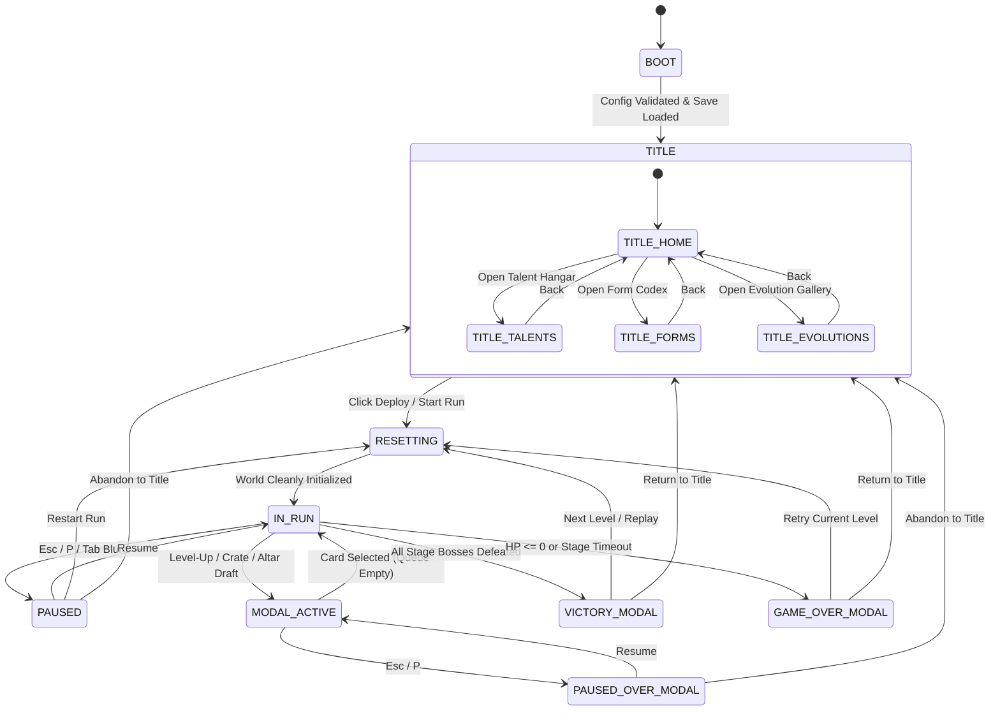

# 03. System Modules & State Lifecycle Design (V2.0)

> 🌐 **Language**: [简体中文](../03.系统模块与状态流转设计.md) | **English**

> **Document Version**: V2.0 (Campaign Progression, Multi-Boss Settlement & Career Reset)  
> **Architectural Principle**: Strictly unidirectional data flow — `Input / DOM UI → GameController → Headless Core / Meta → Read-Only Snapshots & Events → Presentation`.

---

## 1. High-Level Module Boundaries

```text
┌─────────────────────────────────────────────────────────────────────────┐
│                          Presentation Layer                             │
│  InputNormalizer   │   CanvasRenderer   │  UiOverlayManager  │  Audio   │
└─────────┬──────────┴─────────▲──────────┴─────────▲──────────┴────▲─────┘
          │ NormalizedInput     │ RenderSnapshot     │ HudSnapshot   │ Events
          ▼                     │                    │               │
┌─────────────────────────────────────────────────────────────────────────┐
│                    Application Layer (GameController)                   │
│  Fixed-Timestep Accumulator (1/60s) · Macro FSM · SaveManager (V2)      │
└─────────┬───────────────────────────────────────────────────────────────┘
          │ Pure Commands (step, selectDraft, reroll, reset)
          ▼
┌─────────────────────────────────────────────────────────────────────────┐
│                 Headless Simulation Core (src/core/**)                  │
│  SimulationWorld · ProgressionSystem · EconomyCalculator                │
│  SpatialHashGrid · SeededRng (Mulberry32)                               │
│  ⛔ ZERO DOM / Window / Canvas / WebAudio / localStorage imports        │
└─────────────────────────────────────────────────────────────────────────┘
```

---

## 2. Core V2.0 Domain Upgrades

### 2.1 `WorldLifecycleAndResetSystem`
- Owns deterministic world creation (`resetRun(seed, level, metaProfile)`), clearing every entity array, spatial hash bucket, projectile/effect queue, modal queue, and PRNG state with **zero leaked references** across runs.
- Enforces the **Clean Reset Contract**: starting a new run or returning to Title resets `elapsedSec`, `bossesDefeated`, `bossesSpawned`, `activeTelegraphs`, `draftQueue`, and `pendingEvents` atomically.

### 2.2 `WaveDirectorSystem` (Multi-Boss & Timeout Enforcement)
- Reads the current `StageConfig` (`stage_1` … `stage_5`) derived from `currentLevel`.
- Spawns stage-gated enemy tiers according to wave progress while respecting the soft cap (`maxActiveEnemies = 240`).
- Spawns multi-phase Bosses (`boss_void_weaver`) strictly on `bossSpawnTimesSec[]` (2-minute intervals: `120s, 240s, ...`).
- Evaluates settlement deterministically every fixed tick:
  - **Immediate Victory**: `bossesDefeated >= requiredBossCount` → emit `RUN_VICTORY` and transition to `VICTORY_MODAL`.
  - **Timeout Defeat**: `elapsedSec >= stageDurationSec && bossesDefeated < requiredBossCount` → emit `RUN_DEFEAT(reason: 'TIMEOUT')` and transition to `GAME_OVER_MODAL`.
  - **HP Depletion Defeat**: `player.hp <= 0` → emit `RUN_DEFEAT(reason: 'HP_DEPLETED')` and transition to `GAME_OVER_MODAL`.

### 2.3 `ProgressionAndLootSystem` (Slot-Isolated 3-Choice Draft)
- Enforces `maxActiveSlots` and `maxPassiveSlots` from the active `StageConfig` (`2+1 → 4+4`).
- Computes candidate eligibility deterministically via `SeededRng`:
  1. Evolution candidates (`weapon.level === 5 && hasPairedPassive && !isEvolved`) receive priority weighting.
  2. Upgrades to owned active weapons (`< Lv.5`) or owned passives (`< Lv.5`).
  3. Unowned active weapons **only if** `ownedWeapons.length < maxActiveSlots`.
  4. Unowned passives **only if** `ownedPassives.length < maxPassiveSlots`.
  5. If fewer than 3 candidates exist, pad deterministically with infinite fallback cards (`fallback_heal`, `fallback_atk`, `fallback_crystals`).

### 2.4 `MetaProgressionSystem` & `SaveManager`
- Automatically computes `unlockedFormId` from cumulative campaign clears (`0 / 3 / 8 / 16 / 25`).
- Manages 8 permanent talents, cost scaling, **free 100% refund**, and **Career Reset (`resetCareer`)** with confirmation modal.
- Persists `SaveDataV2` to `localStorage` (`void_runner_save_v1`, `schemaVersion: 2`), automatically migrating legacy V1 saves and safely falling back to a fresh profile on corrupted JSON.

---

## 3. Macro Application & Run FSM



---

## 4. Same-Frame Race & Arbitration Rules (5 Invariants)

1. **Death / Timeout Beats Everything**: If `HP <= 0` or `TIMEOUT` occurs on the exact same tick as a level-up or crate pickup, `GAME_OVER_MODAL` wins immediately and all queued drafts are discarded.
2. **Victory Beats Drafts**: If the final required Boss dies on the same tick as an XP gem triggers a level-up, `VICTORY_MODAL` wins immediately—no redundant post-victory card draft appears.
3. **FIFO Modal Queue**: Multiple simultaneous level-ups or crate pickups enqueue into `draftQueue` and resolve strictly one by one; simulation stays frozen (`dt = 0`) until `draftQueue` is completely drained.
4. **Pause Layering (`PAUSED_OVER_MODAL`)**: Pressing `Esc` during a draft overlays the Pause/Settings menu without losing the active draft cards; resuming returns directly to `MODAL_ACTIVE` with the exact same 3 cards intact.
5. **Tab Visibility Guard**: Browser `visibilitychange` (hidden) or `window.blur` while `IN_RUN` automatically transitions to `PAUSED` and discards any huge frame `dt` spike, preventing offline teleportation or instant death on tab return.
