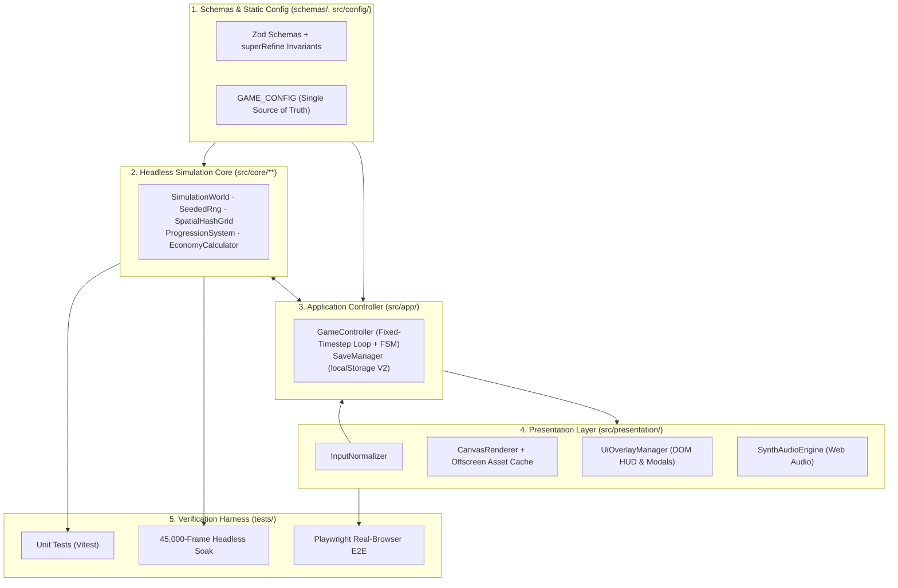

# 04. Tech Stack & Runtime Architecture Design

> 🌐 **Language**: [简体中文](../04.技术选型与运行时架构设计.md) | **English**

> **Document Status**: Stage 4 Architecture Baseline (Frozen)  
> **Core Mandate**: Pure front-end zero-engine runtime delivering locked **60 FPS** with deterministic headless simulation, strict ESLint boundary enforcement, and zero runtime GC thrashing.

---

## 1. Technology Stack & Trade-Off Justification

| Layer | Chosen Technology | Rationale |
| :--- | :--- | :--- |
| **Language** | **TypeScript 5.x (`strict: true`)** | Compile-time enforcement of readonly snapshots, discriminated event unions, and ID literals. |
| **Build Tool** | **Vite 6** | Sub-second HMR during tuning and minimal ESM production bundles (`base: './'` for static hosting). |
| **2D Renderer** | **HTML5 Canvas 2D** | Zero framework overhead, deterministic draw ordering, offscreen sprite/hit-flash caching, universal browser compatibility. |
| **UI / HUD** | **Lightweight DOM + CSS Overlay** | Crisp vector typography, accessible keyboard/mouse hit targets, CSS transitions without polluting the Canvas draw loop. |
| **Audio** | **Procedural Web Audio API** | Zero external MP3/OGG downloads, instant boot, dynamic synthwave BGM + filtered noise SFX unlocked cleanly on first gesture. |
| **Data Contracts** | **Zod 3.x** | Runtime + static type single source of truth for game configs (`gameConfig.ts`) and versioned `localStorage` saves (`SaveDataV2`). |
| **Quality Gates** | **ESLint + Vitest + Playwright** | Static architectural boundary enforcement, headless 45,000-frame soak testing, and real-browser E2E regression checks. |

---

## 2. Five-Layer Headless Decoupling Architecture



### Static ESLint Dependency Guardrails
`eslint.config.js` statically **forbids** any file under `src/core/**` from importing:
- `src/presentation/**` or `src/app/**`
- Browser globals (`window`, `document`, `localStorage`, `requestAnimationFrame`, `AudioContext`, `HTMLCanvasElement`)
- Non-deterministic randomness (`Math.random()`) — all gameplay randomness must go through `SeededRng` (Mulberry32).

---

## 3. Deterministic Fixed-Timestep Loop

- **Fixed Logic Step**: `FIXED_DT = 1 / 60` (`0.016666... s`).
- **Raw Delta Clamp**: `MAX_RAW_DT = 0.05 s` (caps frame hitches so the loop never enters a spiral of death).
- **Substep Budget**: `MAX_SUBSTEPS = 5` per animation frame (supports up to `3×` battle speed cleanly).
- **9-Step Deterministic Tick Pipeline (`SimulationWorld.step(input)`)**:
  1. Advance run clock & status timers (`invulnTimer`, `overloadTimer`, `dashTimer`).
  2. Update player velocity & position from normalized input vector.
  3. Run `WaveDirector` (spawn mobs, elites, multi-phase Bosses on `bossSpawnTimesSec[]`, and dynamic beacons).
  4. Rebuild zero-GC `SpatialHashGrid` (`cellSize = 64 px`) from active enemies.
  5. Update weapon cooldowns & spawn projectiles / orbital blades / beams / lightning strikes.
  6. Advance enemy AI, Boss phase transitions, telegraphs, and contact/projectile collision checks.
  7. Resolve damage, crits, knockback, death splits, loot drops, and XP gem magnetism.
  8. Evaluate win/loss settlement (`VICTORY` / `HP_DEPLETED` / `TIMEOUT`) and drain pending level-up/altar modals per arbitration rules.
  9. Emit read-only `GameEvent[]` batch for Presentation (SFX triggers, damage numbers, hit sparks, screen shake).

### Deterministic PRNG (Mulberry32)
```ts
// Identical seed + identical input stream => bit-for-bit identical simulation trajectory
```
Used across spawn angles, crit rolls, draft shuffling, and beacon placement so any bug or balance anomaly can be reproduced deterministically in Node.js headless soak tests.

---

## 4. Viewport, Zero-GC Spatial Hash & 60fps Budgets

### 4.1 Viewport & DPR Scaling
- **Logical Reference Viewport**: `1280 × 720` (16:9), letterboxed/responsive to fit any window cleanly.
- **Pixel Density Cap**: `effectiveDpr = Math.min(window.devicePixelRatio || 1, 2)` to prevent 4K/Retina fill-rate bottlenecks on Canvas 2D.

### 4.2 Zero-GC 64px Spatial Hash Grid
- Coordinates map to integer grid cells `(gx, gy) = (Math.floor(x / 64), Math.floor(y / 64))`.
- Packed 32-bit integer cell key (zero string allocation per frame):
  ```ts
  const key = ((gx + 32768) << 16) | ((gy + 32768) & 0xffff);
  ```
- Reuses pre-allocated bucket arrays across ticks (`bucket.length = 0`), eliminating per-frame garbage collection spikes during 200+ enemy battles.

### 4.3 Canvas 2D 60fps Performance Budgets

| Category | Hard Budget | Implementation Strategy |
| :--- | :---: | :--- |
| Active Enemies | `≤ 240` | Wave director soft cap + off-screen culling/repositioning |
| Active Projectiles | `≤ 360` | Pooled slots / ring-buffer recycling |
| Active Particles / VFX | `≤ 180` (`≤ 60` in Low-Particle mode) | Pre-allocated object pool; zero `ctx.shadowBlur` in hot loops |
| Floating Damage Texts | `≤ 45` | Pooled text queue with merge/evict on overflow |
| Sprite Hit Flash | `0 ms` runtime pixel loop | Pre-rasterized offscreen white silhouette canvas per sprite at load time |

---

## 5. Production Repository Layout

```text
├── schemas/          # Zod schemas & cross-table superRefine invariants
├── src/
│   ├── config/       # Static GAME_CONFIG validated at boot
│   ├── core/         # 100% headless deterministic simulation & spatial hash
│   ├── app/          # GameController, fixed-timestep loop, SaveManager
│   └── presentation/ # InputNormalizer, CanvasRenderer, AssetStore, HUD, WebAudio
├── public/assets/    # Painted PNG sprites, UI icons & stage backdrops
├── tests/
│   ├── unit/         # Vitest deterministic core, FSM & Zod schema tests
│   ├── sim/          # 45,000-frame multi-seed headless soak tests
│   └── e2e/          # Playwright real-browser end-to-end tests
├── prototype/        # Archived Stage 2 zero-dependency greybox prototype
└── docs/             # Bilingual SDD-G specifications (zh + en/)
```
